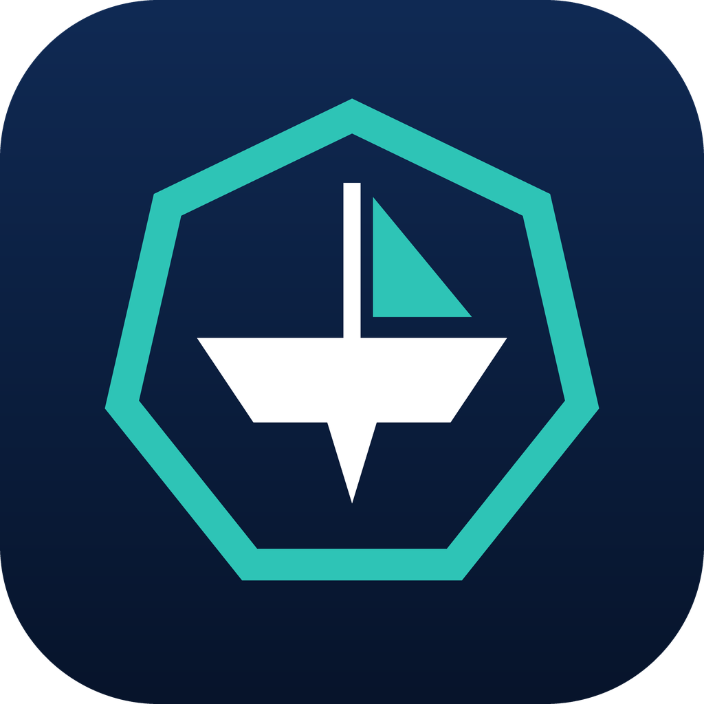
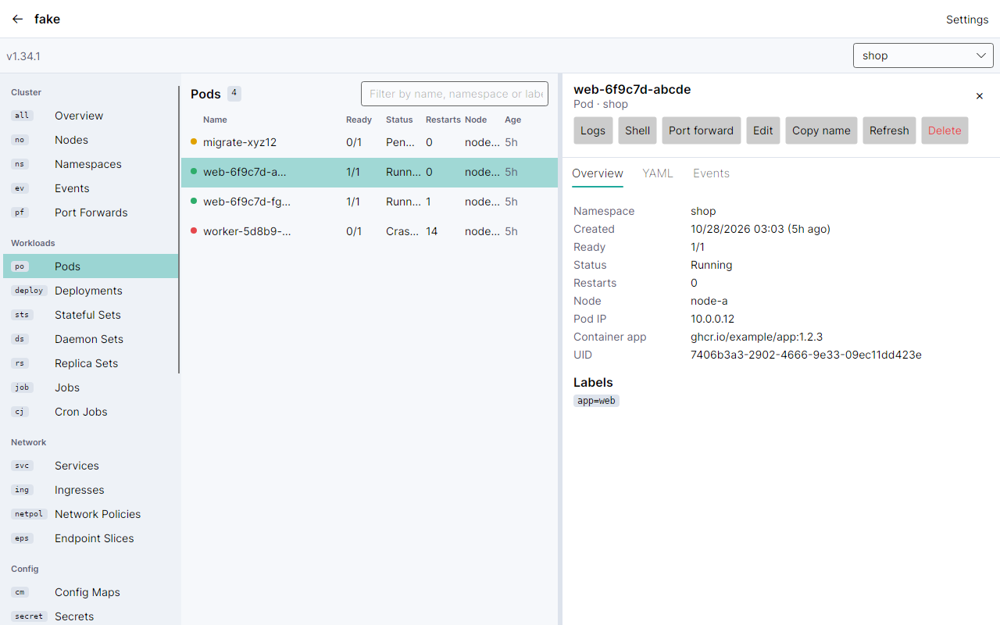
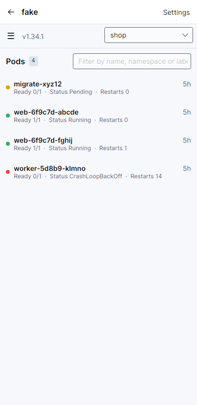

<p align="center">
  
</p>

<h1 align="center">Telltale Kube</h1>

Telltale Kube is a Kubernetes client in the style of Lens / Freelens for Windows, macOS, Linux, Android, iPhone and
iPad. Built using a single .NET 11 codebase on Avalonia, currently compiles to a ~40 MB native app. 

Why did I build this? Because I wanted to keep an eye on my clusters while on the move, and everything currently out
there seemed to have either buried in-app purchases, odd telemetry or was just ... shady as heck. So I built this. And 
figure that there might be other people out there like me who would find something simple, fast, and portable useful.

| Desktop | Phone |
|---|---|
|  |  |

More screenshots can be found here if you are interested: [docs/SCREENSHOTS.md](docs/SCREENSHOTS.md).

## Features

### Clusters and resources
- Import kubeconfigs from a file or the clipboard and pick which contexts to keep. On desktop, `~/.kube/config` and
  `$KUBECONFIG` are also read live. You can also import from your Google Drive etc!
- Live list + watch views for every built-in kind (workloads, networking, config, storage, RBAC) and for CRDs.
- Custom resources are discovered automatically and grouped by product in the sidebar (Longhorn, Flux,
  cert-manager, Gateway API and so on).
- Resource details show health, conditions, containers, labels, annotations, owner chain, events and YAML.
- 
### Lists
- Click a header to sort. Numbers, ages, quantities (`10Gi`), percentages and ready ratios (`2/3`) sort as values.
- Filter with per-column boxes, a health filter, or the query language in the search box:
  `web status:Running restarts:>3 age:<1h label:app=api name:web-* namespace:!kube-system`.
  If you have ever used something like datadog, this will be second nature.

### Stats without Prometheus - thank you kube-metrics!
- The overview shows cluster CPU and memory (usage, requests and limits against allocatable), pod slots, node disk,
  pressure and cordon flags, sparklines, and the top pods by CPU and memory relative to their requests and limits.

### Pods, logs and workloads
- Each pod row has a container strip (● main, ■ sidecar, ○ init, □ debug) coloured by health. READY and RESTARTS
  count native sidecars, just as kubectl does.
- The pod detail has a card per container with role, image, state, restarts and last exit reason.
- Logs for one container or all containers merged, with follow, timestamps, filtering and previous-instance logs.
- "Controlled by" shows the full owner chain, each step clickable, with a back button in the detail pane.

## Security

I have given thought to security too when this was built.

| Concern | Measure |
|---|---|
| Credentials at rest | Device secure storage used |
| TLS | TLS 1.2+ only. The cluster CA is pinned and system roots are not consulted. `insecure-skip-tls-verify` is refused unless allowed per cluster |
| Malicious kubeconfigs | Exec credential plugins need approval of the exact command line (fingerprinted), never run through a shell, and are disabled on mobile |
| Accidental changes | Per-cluster read-only mode enforced in the HTTP pipeline. Cluster-scoped deletes need the name typed back. Scale to zero needs confirmation |
| Secrets in the UI | Masked until revealed. Reveal needs biometrics on mobile. Copied secrets clear from the clipboard after 45 s |
| Lost device | Auto-lock with biometrics or passcode, privacy screen in the app switcher, Android `FLAG_SECURE`, vault excluded from backups |
| Privacy | No telemetry or accounts. The only network calls are to your clusters and the opt-in update check |


## Build

```sh
dotnet test --project tests/TelltaleKube.Core.Tests
dotnet test --project tests/TelltaleKube.App.Tests                 # headless UI tests against a fake API server
dotnet run  --project src/TelltaleKube.Desktop
dotnet publish src/TelltaleKube.Desktop -c Release -r linux-x64    # NativeAOT binary
```

The SDK version is pinned in `global.json`.

## Distribution

I am hoping to (eventually) get this up onto WinGet, Flathub, Android store and the iOS app store - however, some of these
(WinGet) are dependant on me sorting a CodeSigning cert out (which is expensive, and right now not something I can afford to do).

## License

Apache-2.0. See [LICENSE](LICENSE).
